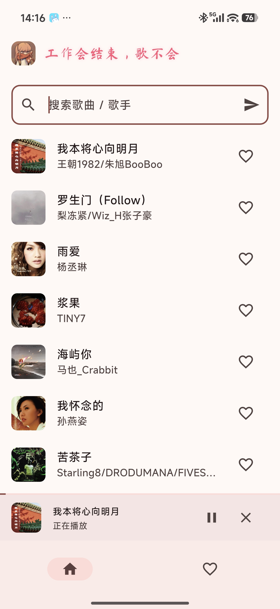
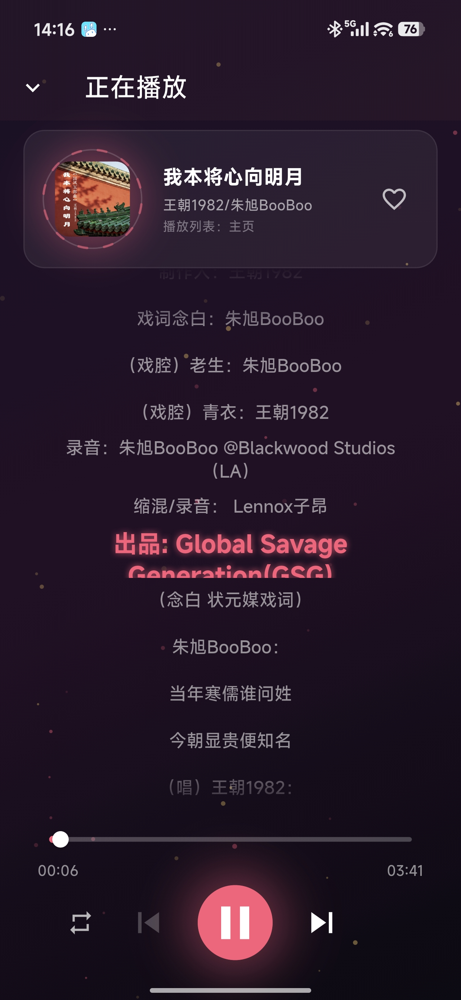

# 小猫音乐

一款治愈系 Android 音乐播放器，简洁的粉白配色，专注听歌本身。

## 预览

### 主页



- 顶部标语 + 搜索栏，支持按歌曲 / 歌手关键词搜索
- 热歌榜首发，下拉触底自动分页加载更多
- 歌曲卡片展示封面 / 标题 / 歌手，右侧心形一键收藏
- 底部常驻 Mini Player，显示当前曲目，点击进入全屏播放器
- 底部 Tab 切换「主页」和「收藏」

### 播放器



- 深色沉浸背景，大尺寸封面 + 同步滚动歌词
- 进度条拖动 / 时间显示准确对齐真实时长
- 三种播放模式循环切换：**顺序 → 随机 → 单曲循环**
- 上一首 / 播放-暂停 / 下一首，播放模式图标位于最左侧
- 心形按钮与主页收藏状态实时同步

### 后台播放与通知栏

- 基于 `audio_service` + `just_audio` 实现真后台播放
- 切到后台后通知栏显示封面 + 上一首 / 播放-暂停 / 下一首
- 锁屏、耳机线控、车载蓝牙按键均能控制
- App 进程被杀后系统恢复 Intent 仍可拉起播放状态

### 收藏

- 收藏数据通过 `shared_preferences` 本地持久化
- 切歌、杀进程、重启 App 收藏列表不丢失
- 「收藏」Tab 集中展示全部收藏曲目，支持再次点击取消

## 技术栈

| 模块 | 依赖 |
|---|---|
| 框架 | Flutter 3.x (Dart SDK ^3.13.7) |
| 网络请求 | `http` |
| 后台播放 / 通知栏 | `audio_service 0.18.x` + `just_audio 0.10.x` |
| 权限（Android 13+ 通知） | `permission_handler` |
| 收藏持久化 | `shared_preferences` |
| 字体 | `google_fonts` |

## 目录结构

```
lib/
├── main.dart             // UI 全部代码（App 入口 + 主页 + 播放器 + 收藏页 + 控制器）
├── audio_handler.dart    // audio_service BaseAudioHandler 实现（队列 / 播放模式 / 后台通知）
├── api_examples.dart     // MetingService + Song 模型 + LRC 解析
├── api.md                // 接口文档
├── 1.json                // 接口响应示例
└── 搜索接口.json          // 搜索接口响应示例
android/                  // Android 原生工程（AudioServiceActivity + MediaSessionService）
ios/ linux/ macos/ web/ windows/  // 平台壳
```

## 接口

歌曲、歌词、封面全部来自 [Meting](https://github.com/injahow/meting-api) 风格 API：

```
https://api.qijieya.cn/meting/
  ?type=search&id=<关键词>&page=1&limit=20      # 搜索 / 热歌榜
  ?type=lrc&id=<歌曲ID>                          # 歌词（纯文本 LRC）
  ?server=netease&type=pic&id=<封面ID>          # 封面图（image/jpg）
  ?server=netease&type=url&id=<歌曲ID>           # 播放源（302 跳转音频 CDN）
```

返回的 Song 对象同时携带 `url` / `pic` / `lrc` 三个完整 URL，UI 层直接消费，无需二次拼装。

## 播放模式

由 `PlayMode` 枚举定义，在 [audio_handler.dart](lib/audio_handler.dart) 内实现完整三态循环：

| 模式 | 图标 | 播完自动 | 手动按「下一首」 |
|---|---|---|---|
| 顺序（默认） | `Icons.repeat` | 列表下一首，末首停 | 列表下一首 |
| 随机 | `Icons.shuffle` 🔴 | 队列中随机挑 ≠ 当前的索引 | 队列中随机挑 |
| 单曲循环 | `Icons.repeat_one` 🔴 | 重播当前 | 列表下一首 |

模式切换通过 `StreamController<PlayMode>` 广播，UI 和通知栏 controls 同时刷新。

## 切歌元数据丢失修复

版本迭代中曾出现「切歌后封面 / 歌词丢失、进度条不准」。根因：

1. 歌词加载用 `identical(_currentSong, song)` 判等，`setUrl` 完成后 `mediaItem.add(copyWith(duration))` 会让 `_currentSong` 指向新对象 → 歌词回调直接丢弃结果。
2. `_duration` 切歌时未重置，沿用上一首的时长。

修复方案：

- `MusicController.playSong` 在调 `audioHandler.playSong` 之前**先同步更新 `_currentSong` 并启动歌词加载**，UI 立即拿到原始 Song 的完整元数据。
- `_onMediaItem` 优先取 `audioHandler.currentSong`（队列里的原始 Song），不再从 `MediaItem.extras` 反序列化。
- 时长通过 `_player.durationStream` 监听，流媒体异步解析出真实时长后实时 `mediaItem.add(copyWith(duration:))`。

## Android 平台配置

### Manifest

必须在 `AndroidManifest.xml` 声明：

- `uses-permission`: `FOREGROUND_SERVICE_MEDIA_PLAYBACK`（Android 14 后台播放）、`POST_NOTIFICATIONS`（Android 13 通知）
- `activity` 使用 `com.ryanheise.audioservice.AudioServiceActivity`（不能是 FlutterActivity）
- `service` 同时声明 `AudioService` + `MediaBrowserService` intent-filter

### MainActivity

```kotlin
class MainActivity : AudioServiceActivity()
```

不能直接继承 `FlutterActivity`，否则 audio_service 无法和 Activity 桥接，导致白屏。

## 构建

```powershell
# 依赖
flutter pub get

# 静态检查
flutter analyze

# Android release 产物
flutter build apk --release
# 输出: build/app/outputs/flutter-apk/app-release.apk
```

## Git 过滤规则

根目录 `.gitignore` 已覆盖 Flutter 模板 + 本项目自定义忽略项：

- 构建产物：`build/`、`android/build/`、`.dart_tool/`
- 本地环境：`local.properties`、`.gradle/`、`.kotlin/`、`ios/Flutter/ephemeral/`
- 签名密钥：`key.properties`、`*.jks`、`*.keystore`
- IDE 配置：`.idea/`、`*.iml`
- 编辑器 / 压缩包：`.trae/`、`*.zip`、`*.apk`、`*.aab`

## License

仅用于学习研究。歌曲版权归网易云音乐所有。
